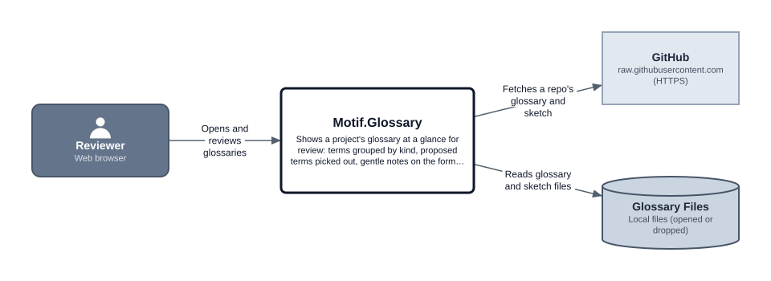
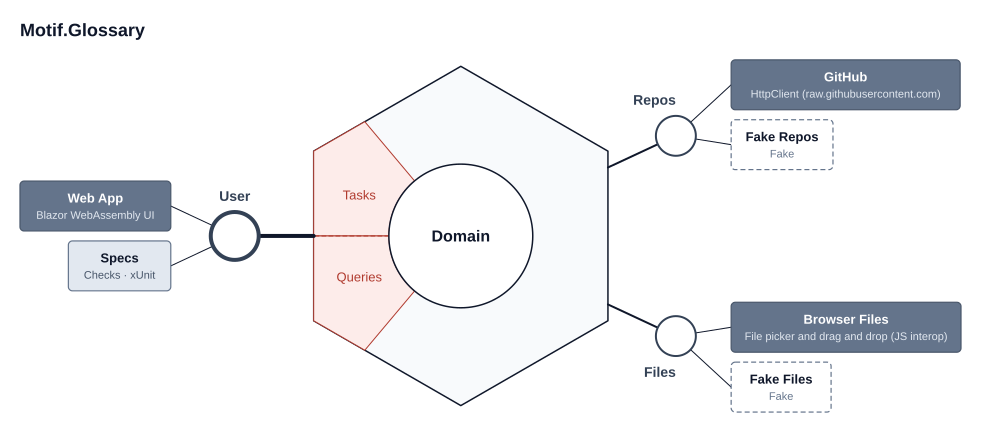

# Motif Glossary

A tool in the **[Motif.NET](https://github.com/motif-dotnet)** suite. It shows a project's glossary, `motif/glossary.md`, in a form that's easy to look at and review: terms grouped by kind, with their Avoid words, status and sketch ids visible at a glance, *proposed* terms picked out, and gentle notes where a term doesn't follow the format or no longer matches the sketch.

It's a Blazor WebAssembly app for GitHub Pages: no server and no accounts. Open or drop a glossary, paste one, or give a public GitHub repo.

The glossary format is in the [Motif Glossary design note](https://github.com/motif-dotnet/.github/blob/main/design/glossary.md). This app started from [motif-dotnet/.github#10](https://github.com/motif-dotnet/.github/issues/10).

## Design

### Context diagram



### Ports and adapters



These pictures are exported by [Motif Sketch](https://motif-dotnet.github.io/Motif.Sketch/) from [motif/sketch.motifsketch.json](motif/sketch.motifsketch.json). The [motif/](motif/) folder holds the design, the [solution plan](motif/plan.md) and the [glossary](motif/glossary.md). The decisions so far are in [decisions.md](decisions.md).

## Status

**v1, read-only viewer.** All four ways in work: open or drop a `glossary.md` (with its sketch file if you like), paste Markdown, a public GitHub repo (`owner/name`, with a shareable `#repo=owner/name` link), and the Example, Motif Sketch's own glossary. The review groups terms by the seven kinds, shows each term's Avoid words, status, In code and sketch ids (resolved to names when there's a sketch file), picks out *proposed* terms with a "Proposed only" filter, and shows gentle format and sketch notes. Light and dark themes, and the same look as Motif Sketch from the suite's web kit.

It deploys to GitHub Pages at <https://motif-dotnet.github.io/Motif.Glossary/> through [.github/workflows/pages.yml](.github/workflows/pages.yml), which runs the specs first.

The glossary reader, sketch-file reader, notes and review live in `Motif.Glossary.Domain`, with no package references, so the planned `dotnet motif` CLI can reuse them. Editing, private repos and comparing versions come later (see [decisions.md](decisions.md)).

## Build and run

You need the .NET 10 SDK.

```
dotnet run --project Motif.Glossary.App   # the app
dotnet test                                # the specs
```
